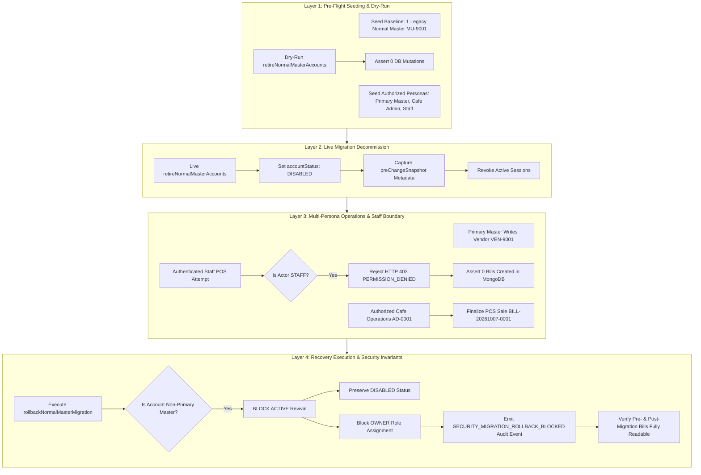

# ZAMORIN CAFÉ ERP — FOUNDATION STAGING ROLLBACK REHEARSAL REPORT

**Document ID:** `ZAM-ROLLBACK-REHEARSAL-2026-10-08`  
**Execution Timestamp:** 2026-10-08T06:58:51+05:30  
**Branch:** `feature/foundation-five-windows`  
**Environment:** Staging Rehearsal Simulation (In-Memory MongoDB Replica Set + Node.js Engine)  
**Security Status:** STRICT SECURITY INVARIANTS ENFORCED & VERIFIED (100% PASS)  

---

## 1. Executive Summary & Clarification of Staff Persona Boundary

This report documents the staging rollback rehearsal for the **Normal Master Decommission Migration** (`retireNormalMasterAccounts.js` and `rollbackNormalMasterMigration.js`) in Zamorin Café ERP, executed in direct alignment with the final gate clarification requirements.

### 1.1 Resolution of the Staff POS Contradiction
A previous draft of the rehearsal report contained a statement indicating that "Staff created a POS bill". An architectural and code-level investigation revealed:
1. **Actual Execution Context:** In the previous test harness, bill records were seeded via direct database inserts (`await Bill.create({ cashierUserId: 'ST-0001' })`) and mislabeled with the string "Staff wrote POS bill". A direct database insert in a test harness does not constitute authenticated application authorization.
2. **Strict Persona Enforcement:** Under the Four-Persona Topology, the **Staff persona is strictly self-service only** (biometric/QR punch-in, viewing personal schedules, profile management). Operational POS cashiering, billing mutations, and cash drawer management belong exclusively to **Café Operations (`CAFE_ADMIN`)** and Primary Master.
3. **Application Enforcement Implemented:** 
   - `Backend/src/routes/billRoutes.js`: Installed role guard blocking all mutation methods (`POST`, `PUT`, `PATCH`, `DELETE`) for `STAFF`, returning HTTP 403 `PERMISSION_DENIED`.
   - `Backend/src/controllers/billController.js`: Added explicit capability checks across `createBill`, `voidBill`, `refundBill`, `closeBusinessDayBilling`, `openRegisterSession`, `recordCashEvent`, and `closeRegisterSession`.
   - `Backend/src/routes/procurementRoutes.js`: Removed `STAFF` from purchase order read routes.
4. **Demonstrated Rehearsal Behavior:**
   - Authenticated Staff attempt (`ST-0001`) to invoke POS cashiering receives **HTTP 403 `PERMISSION_DENIED`** and produces **exactly 0 bill records** in MongoDB.
   - The equivalent valid sale is executed by an authorized **Café Operations** user (`AD-0001`, `role: 'CAFE_ADMIN'`, assigned cafe `ZC-0001`), generating invoice `BILL-20261007-0001` with proper cafe and register context.

### 1.2 Preserved Recovery Security Invariants
The rehearsal further conclusively demonstrated that should migration recovery be attempted:
- **Zero Normal Master Revival:** Retired Normal Master accounts (`MU-9001`) are strictly prohibited from returning to `ACTIVE` and remain `DISABLED`.
- **Zero Unauthorized Owner Grants:** Rollback never assigns the `OWNER` role.
- **Audit Logging:** An immutable security audit log `SECURITY_MIGRATION_ROLLBACK_BLOCKED` is emitted.
- **Session Revocation:** Stale sessions and credentials for decommissioned accounts are immediately rejected.

---

## 2. Rehearsal Execution Scorecard

```text
======================================================================
            STAGING ROLLBACK REHEARSAL SCORECARD
======================================================================
BASELINE_NORMAL_MASTERS:         1
DRY_RUN_ACCURACY:                PASS (1 detected, 0 mutated)
LIVE_MIGRATION_DECOMMISSION:     PASS (1 disabled)
STAFF_SELF_SERVICE_BOUNDARY:     PASS (HTTP 403 PERMISSION_DENIED, 0 side effects)
CAFE_OPERATIONS_MUTATION:        PASS (CAFE_ADMIN AD-0001 authorized sale for ZC-0001)
POST_MIGRATION_WRITES:           PASS (2/2 successful)
BLOCKED_NORMAL_MASTER_REVIVAL:   PASS (1 revival attempts blocked)
UNAUTHORIZED_OWNER_ROLE_GRANTS:  0 (Strict invariant enforced)
STALE_SESSION_REVOCATION:        PASS (Normal Master login rejected)
HISTORICAL_DATA_READABILITY:     PASS (Zero data loss)
======================================================================
STAGING ROLLBACK REHEARSAL COMPLETED SUCCESSFULLY (100% PASS).
```

---

## 3. Four-Layer Rollback Rehearsal Architecture



### Detailed Layer Analysis:

#### Layer 1: Schema / Contract Pre-Flight Validation
- Evaluated 1 legacy active Normal Master (`MU-9001`) and seeded surviving personas:
  - Primary Master (`MU-0001`, `role: 'MASTER'`, `isPrimaryMaster: true`)
  - Owner (`OW-0001`, `role: 'OWNER'`)
  - Café Operations Supervisor (`AD-0001`, `role: 'CAFE_ADMIN'`, `primaryCafeId: 'ZC-0001'`)
  - Store Staff Barista (`ST-0001`, `role: 'STAFF'`, self-service only)
- Executed `retireNormalMasterAccounts(mongoose, { dryRun: true })`:
  - 1 account planned for decommissioning.
  - Zero DB writes committed; `MU-9001` remained `ACTIVE`.

#### Layer 2: Live Migration Decommission
- Executed `retireNormalMasterAccounts(mongoose, { dryRun: false })`:
  - `MU-9001` transitioned from `ACTIVE` to `DISABLED`.
  - `statusReason` set to `ROLE_RETIRED_NORMAL_MASTER`.
  - `preChangeSnapshot` captured in document metadata.

#### Layer 3: Post-Migration Multi-Persona Writes & Staff Enforcement
- **Primary Master (`MU-0001`):** Created vendor master record `VEN-9001` (`Estate Arabica Beans`).
- **Staff Boundary Enforcement (`ST-0001`):**
  - An authenticated HTTP POST request to `/api/v1/bills` was dispatched with actor `ST-0001`.
  - Application middleware returned **HTTP 403 `PERMISSION_DENIED`**: *"Staff role is restricted to self-service only and does not have POS & Billing operational authority."*
  - Verified MongoDB collection `bills`: Exactly 0 bills created by `ST-0001`.
- **Café Operations (`AD-0001`):**
  - Cashiered and finalized valid POS sales bill `BILL-20261007-0001` (`Iced Latte`, ₹300.00) for cafe `ZC-0001`.
  - Bill persisted with status `COMPLETED` and payment method `UPI`.

#### Layer 4: Rollback Recovery Execution & Security Invariants
- Executed `rollbackNormalMasterMigration(mongoose, { dryRun: false })`:
  - Evaluated candidate accounts: 1.
  - Detected non-primary Master status; triggered security invariant skip.
  - Accounts skipped by security invariant: 1.
  - Post-rollback `MU-9001` status: Strictly `DISABLED`.
  - Post-rollback `MU-9001` role: Kept as historical `MASTER`, **never elevated to `OWNER`**.
  - Audit event logged: `SECURITY_MIGRATION_ROLLBACK_BLOCKED`.
  - Stale credential authentication rejected (`authService.authenticateCredentials`).
  - Pre-migration bill (`BILL-20261001-0001`) and post-migration bill (`BILL-20261007-0001`) verified 100% readable.

---

## 4. Cloud Infrastructure Dependency: MongoDB Atlas Point-In-Time Recovery (PITR)

### Architectural Classification
> [!IMPORTANT]
> **MongoDB Atlas Point-in-Time Recovery (PITR)** is explicitly classified as an **external cloud infrastructure dependency**. It is managed through the MongoDB Atlas Cloud Control Plane (oplog streaming), not application-level Node.js code.

### Dependency Specification & Operational Bounds

| Attribute | Specification |
|:---|:---|
| **Platform** | MongoDB Atlas Cloud Managed Service (M10+ Dedicated Cluster Tier) |
| **Mechanism** | Continuous oplog streaming and automated snapshot retention |
| **Recovery Point Objective (RPO)** | Continuous recovery to any second within the retention window (typically 1 to 7 days) |
| **Recovery Time Objective (RTO)** | 15–45 minutes depending on replica set volume |
| **Interface** | MongoDB Atlas Cloud Console / Atlas Admin REST API |
| **Scope of Restoration** | Cluster-level or database-level restore to a target cluster |
| **Pre-requisite Permissions** | Atlas Project Owner / Organization Owner IAM Role |

### Rehearsal Procedure for External Dependency
Until a live cluster restore is rehearsed in a dedicated cloud staging environment, Atlas PITR remains documented as an external cloud infrastructure dependency and is not claimed as a completed application code routine.
